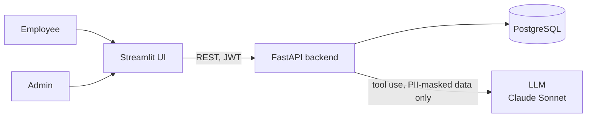
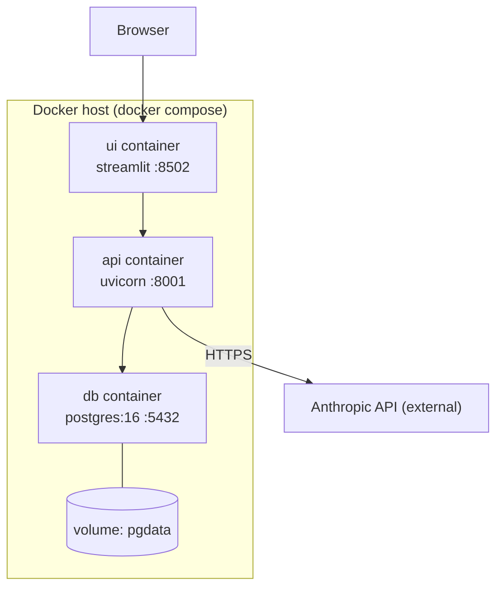
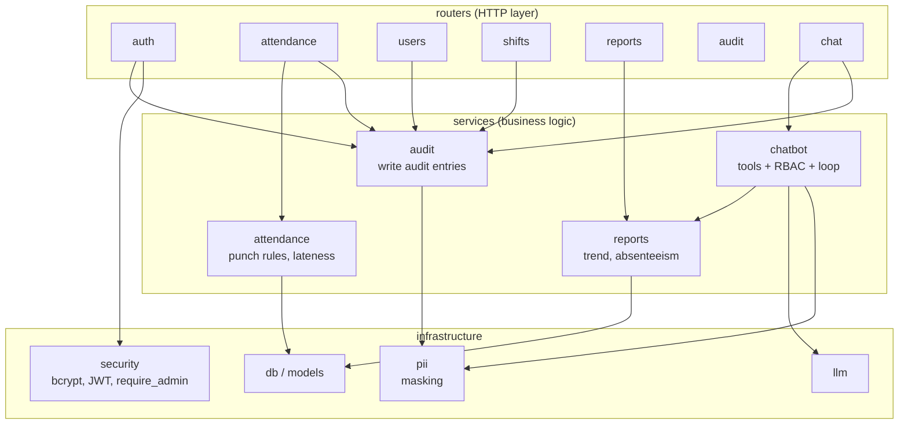
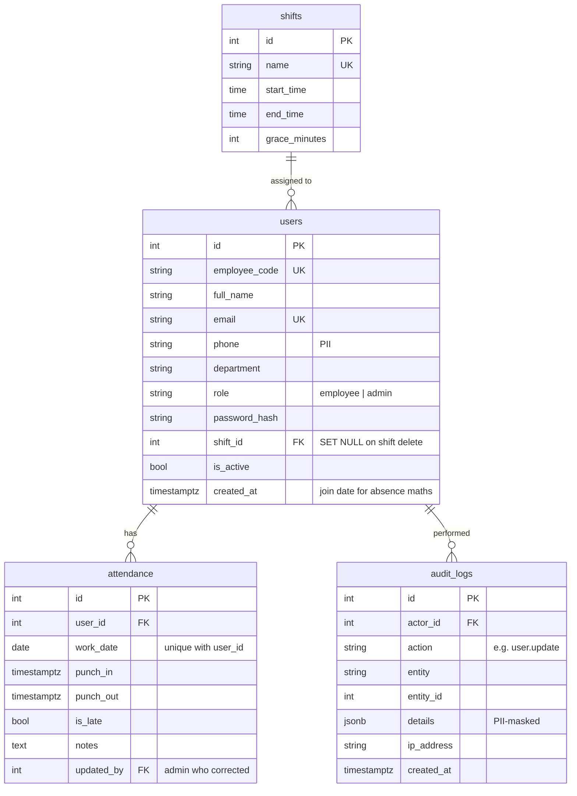
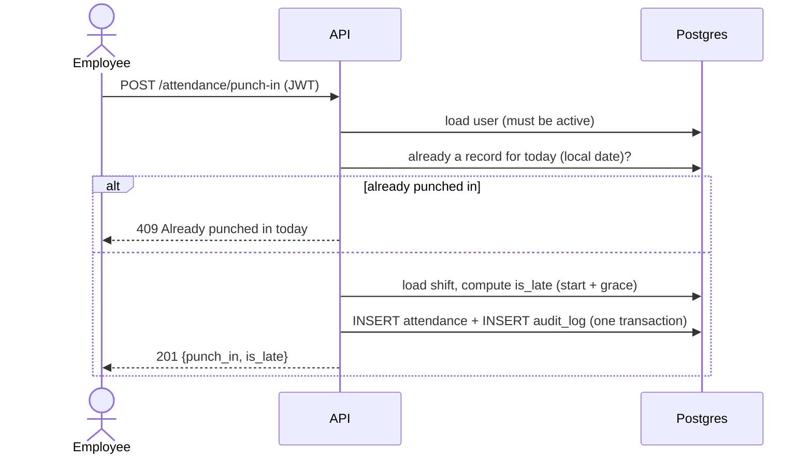
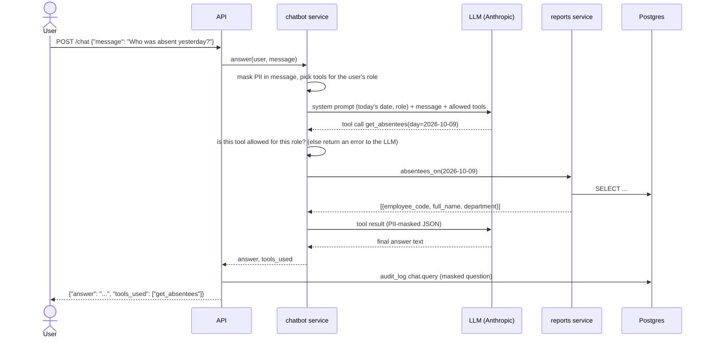
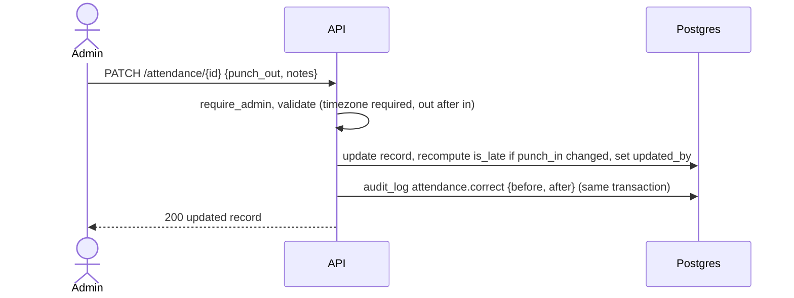
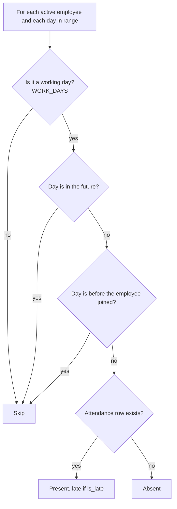

# Attendance Platform: Architecture

## 1. High-level architecture

The UI is a thin client. All rules (roles, punch rules, masking, auditing) live in the API, so they apply to every client.

## 2. Deployment

- **Health checks:** `db` uses `pg_isready`. `api` uses `GET /health`, and `ui` waits for a healthy `api`.
- **Restart policy:** `unless-stopped`. The API retries the DB connection on startup.
- The API is fully stateless (JWT auth, all data in Postgres), so you can run more replicas behind a load balancer, or point `DATABASE_URL` at Supabase/RDS and drop the `db` container.

## 3. Components

The chatbot does not have its own data access. Its tools call the same `reports` functions the admin dashboard uses, so the bot and the dashboard always agree.

## 4. Database (ER diagram)

Design notes:
- **`UNIQUE(user_id, work_date)`** guarantees one record per person per day, even if two punch-in requests race. It also serves as the index for per-user lookups. A separate index on `work_date` speeds up date-range reports.
- **Absence is derived, not stored.** "Absent" means a working day with no row. This avoids nightly jobs that write absent rows, and the numbers are always consistent with the punches.
- **Users are deactivated, never deleted**, so attendance and audit history stay complete. Audit `actor_id` uses `SET NULL`, so audit rows survive anyway.
- **Timestamps are `timestamptz`** (stored in UTC); `work_date` and lateness are computed in the configured company timezone.
- **Audit `details` is JSONB**, so each action can store its own shape (e.g. before/after for corrections).

## 5. Sequence diagrams

### Punch in

### Chatbot question (tool calling with RBAC and PII masking)

### Admin correction

### How "absent" is decided

## 6. Non-functional requirements

| Area | What's done |
|---|---|
| **Security** | bcrypt hashes; signed JWTs with expiry; `require_admin` on every admin route; role and active status re-read from the DB on every request; you can't deactivate or demote yourself; Pydantic validation (email, phone format, password length, timezone-aware datetimes, date-range limit); the LLM only sees masked data and can't run arbitrary queries; non-root container; secrets in env vars only |
| **Auditability** | Every change and every login (including failures) is in `audit_logs` with actor, action, entity, IP, time and masked details. It's written in the same transaction as the change, so a change can never be saved without its audit row. |
| **Scalability** | Stateless API (scale horizontally); connection pooling; indexed date-range queries; date ranges capped at 366 days so reports stay bounded |
| **Observability** | JSON logs with request id, status and latency on every request; chatbot tool calls are logged; `/health`; `X-Request-ID` response header |
| **Resilience** | LLM timeout and 2 retries with backoff; an LLM outage returns a clean `503` while the rest of the app keeps working; tool errors go back to the LLM as data instead of crashing; the unique constraint handles punch races; DB retry on startup; `pool_pre_ping` |
| **Maintainability** | Same layout as the RAG project; the chatbot reuses the report functions; adding a chatbot capability means adding one tool definition and one `if` branch |
| **Performance** | Reports load each date range's rows in one query and compute in memory (no N+1 queries); the chatbot is capped at 4 tool rounds |

## 7. Design decisions and trade-offs

| Decision | Why | Trade-off / what I'd do at larger scale |
|---|---|---|
| **Chatbot uses fixed tools, not text-to-SQL** | Safe (no SQL injection or data leaks through the LLM), RBAC is easy to enforce, and the answers match the dashboard | Can only answer what the tools cover. New questions need a new tool, which is a small change. |
| **RBAC applied twice for the chatbot** (tool list per role + a check before running) | Even if the model "invents" an admin tool call, the server refuses it | None worth mentioning |
| **PII policy: contact details never reach the LLM; names do (admins only)** | Names are needed to answer "who was absent?", and admins are already allowed to see them. Emails/phones are never needed. | Stricter setups could pseudonymise names (E003 → "Employee A") and map them back after the LLM replies. |
| **Absence computed on the fly** | Always correct; no scheduled jobs | Reports compute in Python: O(employees × days), which is fine for thousands of employees. At much larger scale, use SQL `generate_series` aggregation or a nightly summary table. |
| **One attendance row per day** (single punch in/out) | Matches the brief; simple rules | Breaks or multiple sessions per day would need a `punches` table. |
| **Deactivated employees are excluded from reports** | Reports reflect the current workforce | Historic reports for people who left would need a `left_at` date. |
| **Lateness stored at punch time** (`is_late`) | Fast reports; history doesn't change if a shift is edited later | Changing a shift doesn't re-grade old days. That's intentional, but worth knowing. |
| **`create_all` instead of migrations** | Fewer moving parts for a first version | Use Alembic once the schema needs to change in production. |
| **Anthropic Messages API (`anthropic` SDK)** | Tool use via Claude; `ANTHROPIC_API_KEY` and model in env | Depends on Anthropic availability and quotas. |
| **Sync SQLAlchemy** | Simple and readable | Add uvicorn workers for more throughput; async if needed. |
