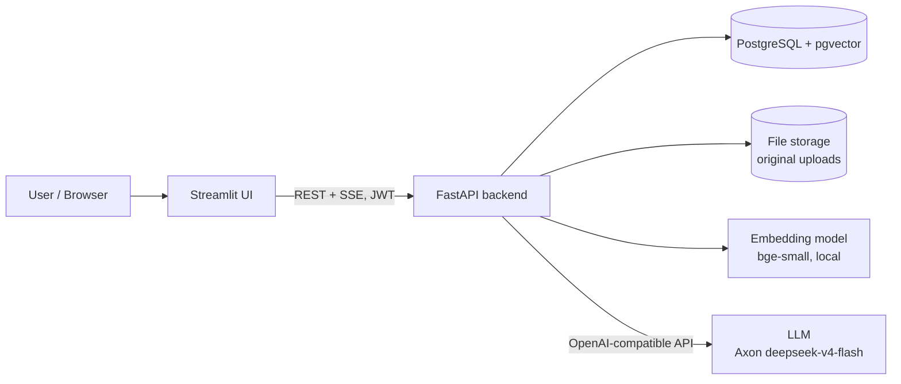
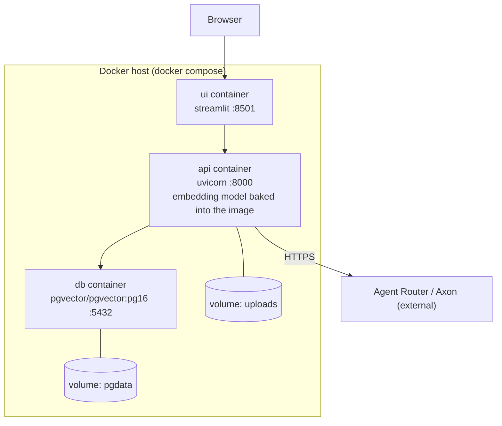
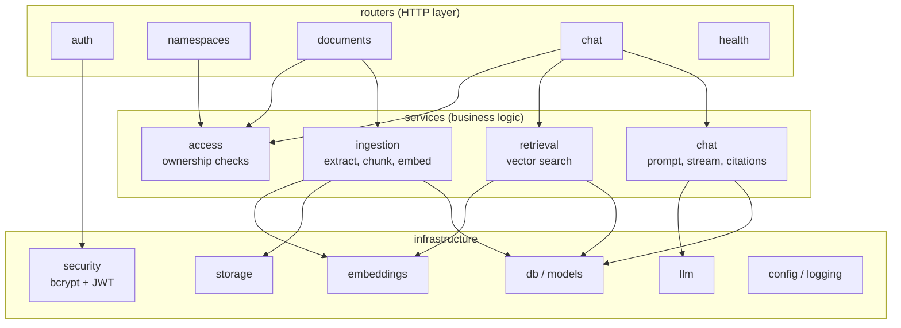
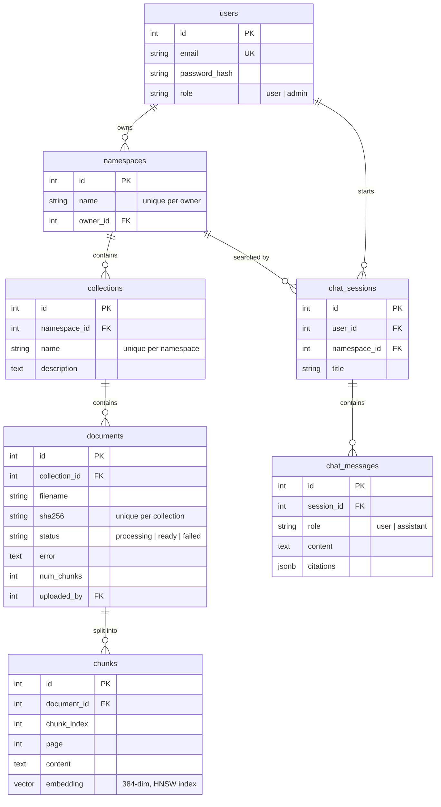
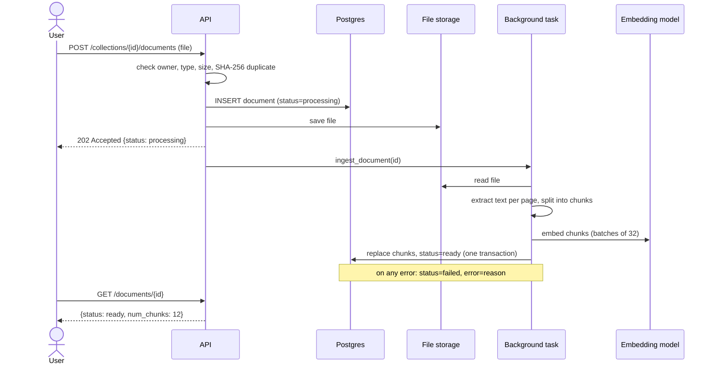
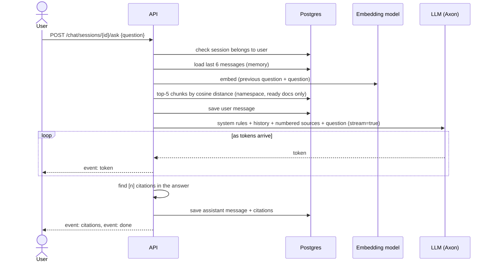
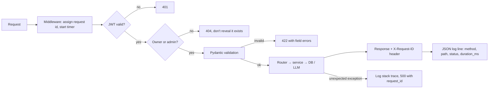

# RAG Assistant: Architecture

## 1. High-level architecture

The UI is a thin client: everything goes through the API, so any other client (mobile, Slack bot, curl) gets the same behaviour and the same security checks.

## 2. Deployment

- **Health checks:** `db` uses `pg_isready`. `api` uses `GET /health`, and `ui` only starts once `api` is healthy.
- **Restart policy:** `unless-stopped`. On startup the API retries the database connection with backoff.
- **Swap to managed services:** set `DATABASE_URL` to Supabase (or RDS) and drop the `db` container. The API is stateless apart from the uploads folder, which would move to S3 in a multi-instance setup (see trade-offs).

## 3. Components

Routers only handle HTTP: they parse input, call services, and shape the response. Services contain the logic and can be tested on their own. `llm`, `embeddings` and `storage` are small wrappers, so the provider can be swapped (OpenAI, Ollama or S3) in one file.

## 4. Database (ER diagram)

Design notes:
- **`ON DELETE CASCADE`** all the way down. Deleting a namespace removes its collections, documents, chunks and chats in one statement, so nothing is left orphaned.
- **Unique constraints** enforce the rules in the database itself: no duplicate names, and no duplicate files in one collection.
- **HNSW index** (`vector_cosine_ops`) on `chunks.embedding` keeps similarity search fast as the table grows. Foreign-key columns are indexed for the joins.
- Citations are stored as **JSONB** on the message, so chat history shows the same sources later even if the document has since been deleted.

## 5. Sequence diagrams

### Upload and indexing

### Asking a question (streaming + memory + citations)

### Request flow (every request)

## 6. Non-functional requirements

| Area | What's done |
|---|---|
| **Security** | bcrypt hashes; signed JWTs with expiry; every query is scoped to the owner (other users' resources return 404); input validation; upload type/size limits; filenames are never used as paths (files are stored by id); the container runs as a non-root user; secrets live only in env vars |
| **Scalability** | The API is stateless (JWT, no server sessions), so you can run more containers behind a load balancer. Uses DB connection pooling and an HNSW vector index. Indexing runs after the response, so uploads return immediately. |
| **Observability** | Structured JSON logs with request id, latency and status on every request, plus events (indexed, failed, streamed) with ids. `/health` for probes. `X-Request-ID` is returned so users can quote it in bug reports. |
| **Resilience** | LLM client has a timeout and retries (2, with backoff, on 429/5xx). An LLM failure becomes a clean SSE `error` event. A failed document is marked `failed` with the reason and can be re-indexed. Startup retries the DB. `pool_pre_ping` drops dead connections. |
| **Maintainability** | Same layered layout in both projects; small single-purpose modules; providers behind one-file wrappers; config only via env; tests for the main flows |
| **Performance** | Embeddings run locally (no network hop); chunks are embedded in batches; the embedding model is loaded once and baked into the image; answers are streamed, so the first words appear in under a second |

## 7. Design decisions and trade-offs

| Decision | Why | Trade-off / what I'd do at larger scale |
|---|---|---|
| **pgvector instead of a separate vector DB** | One database for everything: transactions, joins for access control, cascade deletes, one backup | A dedicated vector DB (Qdrant, Pinecone) scales further at hundreds of millions of vectors. With many tenants in one HNSW index, filtered search can return fewer than k results; fix with pgvector iterative scans or per-tenant partitions. |
| **Local embeddings (fastembed, bge-small)** | Free, no rate limits, no data leaves the server, fast on CPU | Lower quality than large hosted embedding models. Switching model means changing `EMBEDDING_MODEL`/`EMBEDDING_DIM` and re-indexing. |
| **Agent Router (Axon) via an OpenAI-compatible client** | Single provider endpoint; model fixed to `deepseek-v4-flash` for consistency. | Depends on Agent Router availability and quotas; top-k and history are kept small to limit token use. |
| **FastAPI `BackgroundTasks` for indexing** | No extra infrastructure; upload returns immediately | Work is lost if the process dies mid-index (the document stays `processing`, and you can re-index it). At scale, use a queue (Celery/RQ/SQS) with retries. |
| **Character-based chunking with overlap and boundary snapping** | Simple, predictable, no tokenizer dependency | Not structure-aware (headings, tables). Could add semantic or heading-based splitting. |
| **Follow-up handling: retrieve with previous question + current question** | Cheap and works for most follow-ups, with no extra LLM call | An LLM "rewrite the question" step is more accurate but doubles LLM calls. |
| **Citations: the model writes `[n]`, the server keeps only cited sources** | Users see exactly which sources back the answer | Relies on the model following instructions. Some models use full-width `【n】` instead of `[n]`; both are handled. |
| **Files on local disk / volume** | Simplest. Isolated behind `storage.py` | Multiple API instances need shared storage. Swap `storage.py` for S3. |
| **`create_all` instead of migrations** | Fewer moving parts for a first version | Schema changes after launch need Alembic migrations. |
| **Sync SQLAlchemy + sync endpoints** | Easier to read and debug; FastAPI runs them in a thread pool | Async would handle more concurrent slow requests per process. Adding workers (`--workers`) is the simple fix. |
| **Namespace = owned by one user, admin sees all** | Clear and easy to reason about | Team sharing would need a `namespace_members` table with roles. |
